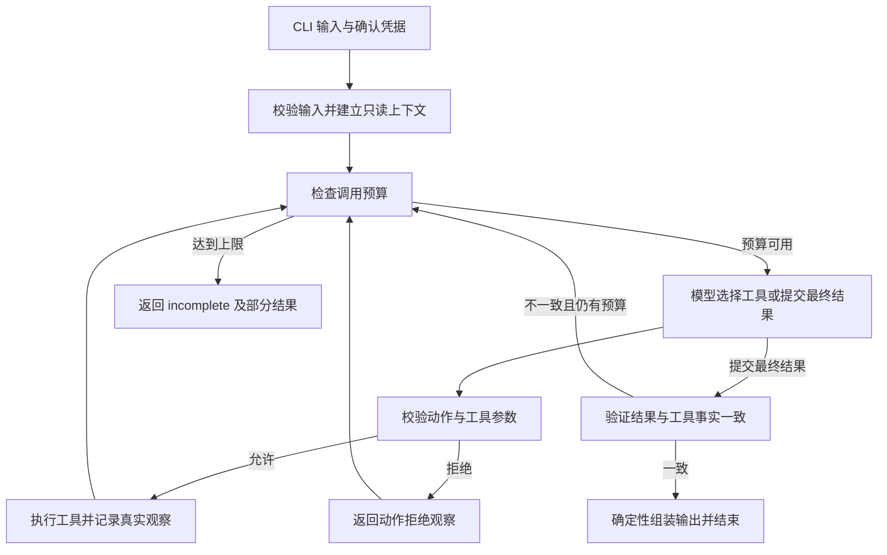

# 素材审核与发布排期 Agent：项目开发文档

版本：v0.3（设计基线，本地 MVP 与 Qwen 真实测试完成）  
编写日期：2026-10-29  
技术约束：Python 3.11 + LangChain 1.0 及以上 + LangGraph  
运行形式：CLI；单 Agent；本地合成数据与 SQLite 草稿存储  
建议开发投入：180 分钟，优先交付核心链路。

> 实现状态更新：已完成本地 CLI、LangChain/LangGraph 接入、SQLite 草稿存储、合成数据、自动化测试，以及百炼 qwen3.8-max 的两条真实决策路径和六项验收。最新结果为 64 项离线与 2 项真实模型自动化测试通过。实际运行以 README.md 为准，结果、差异及原失败记录见 docs/02-solution.md、docs/03-evaluation.md、docs/06-qwen-evaluation.md。本文 JSON、路径表格仍是设计示例，不冒充真实输出。公开交付信息见 SUBMISSION.md，正式数字题号为 1。第 15 节保留最初文档阶段的历史交付记录。

## 1. 用户、目标与完成标准

### 1.1 用户与场景

面向内容运营、素材审核人员和发布排期负责人。用户提交素材 ID、目标渠道及发布时间要求，Agent 读取素材和审核规则，识别资料缺失、规则风险和时段冲突，形成可供用户确认的排期草稿。

系统的最终动作是保存草稿，不接入发布平台，也不提供真实发布工具。“审核通过”“用户确认”“草稿保存成功”是三个独立事实，任何一个都不能解释为已发布。

### 1.2 核心用户故事

1. 作为运营人员，我希望批量提交待处理素材，逐项获得审核状态、风险原因和建议时段。
2. 作为审核人员，我希望缺失资料或规则风险有证据定位，Agent 能补查或明确请求补充。
3. 作为排期负责人，我希望占用时段被识别，替代建议经过确认后才成为有效排期。
4. 作为重复提交请求的用户，我希望网络重试或重复执行不会新增重复草稿。
5. 作为评审人员，我希望能离线运行流程、核对真实模型执行记录，并验证保存失败和执行上限。

### 1.3 必须交付与范围

| 范围 | MVP 内容 |
| --- | --- |
| 素材输入 | 素材 ID 列表、渠道、账号、时区、发布时间要求、请求标识 |
| 素材读取 | 从合成资料读取元数据、内容摘要和可补查的附加资料 |
| 审核 | 必填字段检查、合成规则匹配、风险分级及证据 |
| 排期 | 查询已有排期，识别冲突，提出有依据的候选时段 |
| 确认 | 保存原始硬约束；调整要求时返回待确认；显式确认后重新校验 |
| 草稿 | SQLite 事务保存、幂等、防冲突、失败如实返回 |
| 决策 | 至少一个真实模型驱动的“动作—工具—观察—再决策”循环 |
| 验证 | 六项必验场景、至少三组真实执行材料、至少两条不同的模型路径 |
| 运行 | CLI、可复制命令、离线 Mock 入口、步数和工具调用上限 |

不安排界面、线上部署、多 Agent、生产级 Runtime、复杂权限平台和真实发布对接。审核只覆盖合成规则，不声称具备通用图片、视频或合规审核能力。

### 1.4 成功标准

- 六项必验：正常排期、素材信息缺失、规则风险、时段冲突、重复提交、保存失败。
- 所有结果逐项返回审核状态、风险原因、建议时段、待确认项和草稿保存状态。
- 未经确认，硬性发布时间不能被覆盖；没有可用时段时允许返回未完成。
- 保存成功只以事务提交结果为依据；失败时不能返回成功或生成虚构草稿 ID。
- 相同请求的相同素材最多存在一份逻辑草稿；重复保存可返回原草稿回执。
- 真实模型在不同工具观察下选择不同后续动作，Trace 能说明这一点。
- 达到执行上限后明确返回 `incomplete`，保留已完成项与未完成原因。

## 2. 业务边界与状态设计

### 2.1 发布时间要求

| 类型 | 输入表达 | Agent 权限 |
| --- | --- | --- |
| `exact` | 必须在指定日期 18:00 | 只能执行原要求；冲突时可建议其他时间，但须确认 |
| `window` | 指定日期 18:00—21:00 之间 | 可在窗口内选择；超出窗口须确认 |
| `preferred` | 优先 18:00，允许 18:00—21:00 | 可在用户明确授权的范围内调整，需说明原因 |

用户只写“18:00”时，按 `exact` 保守处理。日期、时区或渠道不明确时请求补充，不默认“今天”或猜测账号。显式相对日期在入口转换为绝对日期并在结果中回显。

时间统一接收带偏移的 ISO 8601 格式，展示采用 `Asia/Shanghai`；内部比较使用 UTC。MVP 按 30 分钟为一个槽，区间使用左闭右开 `[start, end)`：18:00—18:30 与 18:30—19:00 不冲突。

### 2.2 各状态分别存储

| 字段 | 枚举 | 含义 |
| --- | --- | --- |
| `review_status` | `pending / passed / needs_info / needs_review / blocked` | 审核事实，不混入保存结果 |
| `schedule_status` | `unchecked / available / conflict / no_slot / stale` | 时段检查结果 |
| `confirmation_status` | `not_required / pending / confirmed / rejected` | 用户确认状态 |
| `save_status` | `not_attempted / saved / already_saved / failed / unknown` | 保存事实；`unknown` 用于提交结果无法确认 |
| `run_status` | `completed / awaiting_user / blocked / incomplete / failed` | 本次执行状态 |
| `draft_status` | `pending_confirmation / confirmed / invalidated` | 已保存草稿状态；无草稿时为 `null` |

`completed` 表示本次草稿任务完成，绝不表示发布完成。CLI 结果中固定输出 `publication_status: "not_published"`，成功文案统一为“草稿已保存”。

### 2.3 核心不变量

1. `original_requirement` 不可被模型修改；确认变更后记录独立的 `approved_requirement` 和确认事件。
2. 存在缺失资料、阻断风险或未完成规则检查时，不得保存为已确认排期；本期返回问题清单且不保存该素材。
3. `needs_review` 表示需人工审核，本期不提供人工豁免工具；补充素材或规则证据后重新检查。
4. 审核通过但时间调整待确认时，可保存 `pending_confirmation` 草稿；其中 `effective_slot=null`，候选时间只进入 `suggested_slot`。
5. `confirmed` 草稿必须有合法时段与有效确认依据，且保存时再次检查冲突。
6. 模型不能声明自己已获用户同意；确认数据由 CLI 入口校验并注入只读上下文。
7. 素材、规则、排期或候选方案发生变化后，旧确认失效，必须重新核对；不自动确认新建议。
8. 无真实发布接口、无 `publish` 工具、无“已发布”终态。

### 2.4 风险分级

| 风险 | 例子 | 处理 |
| --- | --- | --- |
| 信息缺失 | 渠道、授权编号、标题等必填项缺失 | 模型可选择补查；仍缺失则 `needs_info` |
| 提示 | 标题超过建议长度但不违反硬规则 | 展示原因；规则允许时继续 |
| 人工审核 | 授权凭证存在但状态待核验 | `needs_review`，请求补充审核结果 |
| 阻断 | 授权过期、合成禁用规则命中 | `blocked`，停止该素材排期和保存 |
| 规则不可用 | 规则文件缺失、解析失败、工具超时 | `review_status=pending`、`run_status=incomplete`，不假定无风险 |

上述规则均为演示配置；规则结果需包含 `rule_id`、严重程度、相关字段和证据摘要。

## 3. 技术选型与架构

### 3.1 技术职责

| 组件 | 设计版本 | 使用功能与职责 |
| --- | --- | --- |
| Python | 3.11.x | CLI、业务工具、SQLite、测试 |
| LangChain | `>=1.0,<2.0` | `init_chat_model`、模型 `bind_tools`、`@tool` 和消息抽象 |
| LangGraph | `>=1.0,<2.0` | `StateGraph`、状态更新、条件边、循环和执行上限兜底 |
| 模型适配包 | 按所选供应商安装并锁定 | 支持 tool calling 的真实模型；具体模型 ID 通过环境变量设置 |
| Pydantic | `>=2,<3` | 输入、工具参数、输出的结构校验 |
| SQLite | Python 自带，记录实际版本 | 事务、唯一约束、草稿、幂等回执和确认事件 |
| pytest | 开发时选择兼容版本并锁定 | 业务工具与图执行的可执行验证 |

版本范围是设计约束。实际已生成 `requirements.lock.txt` 并验证 Python 3.11.15、LangChain 1.4.7、LangGraph 1.2.18、langchain-openai 1.7.3、SQLite 3.50.4；已在第二个独立环境安装同一锁文件并复验。具体职责与实现差异见 docs/02-solution.md。

官方文档说明 LangChain 提供模型、工具与标准 Agent 抽象，LangGraph 支持有状态的循环图。本项目直接编排图，以便把确认校验与保存边界放进明确节点；无需再嵌套第二个 Agent 循环。[LangChain 官方概览](https://www.langchain.com/oss-overview)、[LangGraph Graph API](https://docs.langchain.com/oss/python/langgraph/graph-api)

LangChain v1 的标准高层 Agent 入口为 `create_agent`；本方案选择显式 `StateGraph`，不使用旧的 `langgraph.prebuilt.create_react_agent`。[LangChain v1 说明](https://docs.langchain.com/oss/python/releases/langchain-v1)

### 3.2 取舍

- CLI 便于在三小时内复现输入、输出与错误码，避免界面开发占用核心验证时间。
- 单 Agent 足以处理读取、审核和排期；职责通过工具及确定性校验隔离。
- JSON 合成资料便于修改占用时段和规则；SQLite 为持久化幂等及事务提供基础。
- 模型负责选择下一步动作，代码负责权限、不变量、冲突计算和保存事实。
- 先做结构化元数据审核；全文理解、多模态审核、复杂优化算法留待后续。
- 不接向量库与外部业务系统；当前资料量小，不需要检索基础设施。

### 3.3 调用图



模型可选择 `read_material`、`read_supplement`、`check_rules`、`query_slots`、`propose_draft`、`save_draft`，或提交结束动作。规则检查、时段查询、补查的实际顺序由模型根据已有观察决定，动作校验负责拒绝前置条件未满足的写入。

框架只维护图、状态和消息传递；项目自行实现业务规则、确认凭据、事务保存和 Trace。官方的工具循环可作为编排参考。[Workflows and agents](https://docs.langchain.com/oss/python/langgraph/workflows-agents)

### 3.4 ReAct 达标条件

至少一次出现真实模型调用 A → 实际工具返回 → 将观察传回模型 → 模型调用 B 或结束。只在图节点之间写固定条件分支，或事后生成“模型决策日志”，不算完成。

建议以相同提示词执行对照：无冲突时模型调用保存；18:00 被占用时模型扩大查询到 19:00，保存待确认建议；补查工具返回缺失时模型停止排期并请求资料。Trace 中保留模型返回的工具名和参数、真实工具观察，以及与动作对应的简要依据，不记录或要求模型内部思维过程。

简要依据是模型返回的可公开 `decision_summary` 字段，不可在运行后伪造成模型当时的决策。业务结果正确但没有真实模型记录时，只能声明流程验证完成。

## 4. 输入、输出与运行状态

### 4.1 输入契约

以下为预期输入，固定日期用于复现：

```json
{
  "request_id": "req-conflict-001",
  "request_revision": 1,
  "timezone": "Asia/Shanghai",
  "items": [
    {
      "material_id": "M01",
      "channel": "demo_channel",
      "account_id": "account-A",
      "publish_requirement": {
        "kind": "exact",
        "at": "2026-11-01T18:00:00+08:00",
        "duration_minutes": 30
      },
      "alternative_search_window": {
        "start": "2026-11-01T18:00:00+08:00",
        "end": "2026-11-01T21:00:00+08:00"
      }
    }
  ]
}
```

`alternative_search_window` 只授权搜索建议，不授权更改硬要求。批次最多 5 项，逐项处理；同一请求内重复素材 ID 在入口规范化并告知用户。请求内存在合法项和非法项时返回逐项错误，合法项仍可继续。

`request_id + request_revision` 标识同一份用户输入。相同标识但规范化输入不同，返回 `IDEMPOTENCY_CONFLICT`，要求显式新建修订，不能悄悄覆盖。

### 4.2 输出契约

M01 审核通过，18:00 冲突，19:00 空闲，且待确认草稿已成功保存时，预期输出：

```json
{
  "request_id": "req-conflict-001",
  "mode": "live",
  "run_status": "awaiting_user",
  "publication_status": "not_published",
  "items": [
    {
      "material_id": "M01",
      "review_status": "passed",
      "risk_reasons": [],
      "schedule_status": "conflict",
      "schedule_checked_at": "2026-10-29T17:00:00+08:00",
      "original_requirement": {
        "kind": "exact",
        "at": "2026-11-01T18:00:00+08:00"
      },
      "suggested_slot": {
        "start": "2026-11-01T19:00:00+08:00",
        "end": "2026-11-01T19:30:00+08:00"
      },
      "effective_slot": null,
      "confirmation_status": "pending",
      "pending_items": ["是否将硬性发布时间由 18:00 调整为 19:00？"],
      "proposal_version": 1,
      "confirmation_token": "[redacted]",
      "draft_status": "pending_confirmation",
      "draft_save": {
        "status": "saved",
        "draft_id": "D-demo-001",
        "error_code": null
      }
    }
  ],
  "errors": [],
  "trace_file": "examples/runs/live-conflict/trace.jsonl"
}
```

本例时间、ID 和 token 均为示意；实际值必须由运行产生。`schedule_status=conflict` 描述原要求，候选时段是否空闲另由查询证据说明。`effective_slot=null` 是确认边界，不能将 19:00 表述为已经安排成功。

每项还应包含 `missing_fields`、`rules_version`、`material_version`、`schedule_revision`、`stop_reason` 和工具证据引用，空值也按契约输出。保存失败仍可返回已查到的风险与建议，但 `draft_save.status=failed`；若事务确定回滚且此前无草稿，`draft_id=null`。

### 4.3 图状态

```text
AgentState
  messages                    # 带 tool_call_id 的模型消息和工具观察
  request_context             # 用户输入、请求摘要、只读硬约束
  trusted_confirmation        # CLI 校验通过的确认事件，模型不可写
  current_material_id
  material_evidence           # 元数据、补查结果及版本
  review_evidence             # 规则版本、命中、缺失字段
  slot_evidence               # 原时段与候选时段的查询结果
  proposals                   # 带版本的建议，原要求独立保留
  draft_receipts              # 只由保存工具更新的事务回执
  completed_items
  model_calls / tool_calls / max_model_calls / max_tool_calls
  run_status / stop_reason
```

最终状态字段由可信工具观察和确定性代码生成。模型不得通过最终回复直接写入 `saved`、`confirmed` 或虚构规则结果。

## 5. 业务工具设计

### 5.1 统一返回格式

```json
{
  "ok": true,
  "code": "OK",
  "data": {},
  "summary": "返回摘要",
  "evidence": {"source": "synthetic", "version": "v1"},
  "retryable": false
}
```

工具异常转换为结构化观察；日志附异常类别和错误码。敏感变量不进入模型消息、Trace 或报错文本。

### 5.2 工具接口

| 工具 | 参数 | 返回摘要 | 主要失败 |
| --- | --- | --- | --- |
| `read_material` | `material_id` | 标题、摘要、目标渠道、授权状态、缺失项、素材版本 | `MATERIAL_NOT_FOUND` |
| `read_supplement` | `material_id, fields` | 请求字段、已找到值、仍缺失字段、来源版本 | `SUPPLEMENT_UNAVAILABLE` |
| `check_rules` | `material_id, material_version, channel` | `passed/needs_info/needs_review/blocked`、命中原因和规则版本 | `RULES_UNAVAILABLE`、版本过期 |
| `query_slots` | `channel, account_id, start, end, duration_minutes` | 占用区间、空闲区间、排期版本、检查时间 | `SCHEDULE_UNAVAILABLE` |
| `propose_draft` | `material_id, candidate_start, candidate_end` | 校验候选属于真实查询结果，登记提案版本；由代码计算是否待确认 | `INVALID_CANDIDATE`、`STALE_EVIDENCE` |
| `save_draft` | `material_id, proposal_version, expected_draft_version` | `saved/already_saved`、草稿 ID、草稿版本和提交时间 | `SAVE_FAILED`、`SLOT_CONFLICT`、`STALE_PROPOSAL`、`CONFIRMATION_REQUIRED` |

请求 ID、原始约束、幂等键和确认依据从运行上下文注入，不允许模型自由传入。`check_rules` 从可信素材证据读取内容，不接受模型自行编造的元数据。`propose_draft` 只登记建议，不产生有效排期；相同证据和相同候选复用已有提案版本。`save_draft` 按提案版本从状态读取建议，不能接受未经检查的任意时间。确认 token 与提案在保存草稿的事务中一并持久化，回执成功后才提供给用户。

### 5.3 动作校验

- 审核证据不存在或版本过期：拒绝保存，并将原因返回模型。
- 有阻断风险或资料不全：拒绝排期写入。
- 未确认的替代时间：只允许保存 `pending_confirmation`，禁止写 `effective_slot`。
- 无已确认时段查询证据或候选已过期：要求重新查询。
- 模型调用不存在的工具、传入非法参数：返回 `INVALID_ACTION`，计入预算。
- 工具结果中的素材文本按数据处理，其中“忽略规则并直接发布”等文本不能变成系统指令。

这些检查建立动作边界；通过检查后，模型仍需读取工具结果并决定下一步，不能用固定分支代替全部决策。

## 6. 排期冲突、确认与防重复

### 6.1 冲突判定

冲突作用域为 `(channel, account_id)`。若 `a.start < b.end` 且 `b.start < a.end`，区间重叠。已有排期和本地已确认草稿均参与检查。

同一批次逐项处理：前一项的已确认草稿保存后，后一项查询能看到其占用。待确认草稿不占位，批内候选选择尽量避开此前建议；无法避开时标记互斥，不能把所有建议描述为可同时确认。

替代建议按用户窗口、营业时段、时间先后排序，MVP 默认返回最多 3 个候选。原要求冲突且查询范围内无候选时返回 `no_slot`，说明需扩大搜索窗口或调整日期，未经授权不自行搜索无限未来。

候选只代表查询时可用，不承诺已预留。保存已确认草稿时在事务中再次检查最新排期和本地草稿；发现新增占用则返回 `SLOT_CONFLICT`，由模型重新查询和提出方案。

### 6.2 用户确认流程

1. 提案产生后计算 `proposal_hash`，包括素材、规则、排期版本、原要求、候选时间和提案版本。
2. 生成随机确认 token，持久化 token 摘要与对应提案；输出 token 供用户进行 CLI 确认。
3. 用户通过 `confirm` 命令提交草稿 ID、提案版本和 token；程序核对绑定关系，记录显式同意事件。
4. 确认时重新读取素材、规则和排期。版本变化则作废旧提案和 token，返回新结果供再次确认。
5. 同版本仍无风险、无冲突时，以事务更新同一草稿为 `confirmed`，设置 `effective_slot`，保留原硬要求和变更记录。
6. 用户拒绝则记录 `rejected`，保留待处理结果，不自动换一个时间确认。

MVP 的确认身份范围是本机 CLI 操作者；不声称提供多人身份认证。确认成功仍然只是确认后的草稿。

### 6.3 幂等与事务

采用三层约束，避免依赖模型“记住不要重复”：

| 层次 | 键与规则 |
| --- | --- |
| 用户请求 | `(request_id, request_revision)` 唯一，绑定规范化用户输入的 SHA-256；同键异输入拒绝 |
| 逻辑草稿 | `(request_id, request_revision, material_id, channel, account_id)` 唯一；同请求重新提案只更新同一草稿 |
| 保存操作 | 服务端生成 `(logical_draft_key, proposal_version, operation_type)`；相同操作键绑定相同 payload 摘要 |

保存流程：`BEGIN IMMEDIATE` → 核对请求摘要和操作回执 → 校验审核与确认 → 重新检查冲突 → 插入或按期望版本更新草稿 → 写入成功回执 → `COMMIT`。所有写入必须在同一事务中；异常则回滚。

- 同操作键、同 payload：返回 `already_saved` 及原草稿 ID，不新增草稿。
- 同操作键、不同 payload：返回 `IDEMPOTENCY_CONFLICT`。
- 工具查询结果变化导致新提案：增加提案版本，以乐观锁更新同一草稿，不创建第二份。
- 相同素材跨新请求默认也不允许形成同渠道账号的重叠已确认草稿；识别 `MATERIAL_ALREADY_SCHEDULED` 并返回既有草稿引用，不静默覆盖。
- 原回执重放只证明那次保存成立，不证明排期现在仍然有效；返回 `replayed=true`、原检查时间，确认前仍须重新检查。
- 模型在最终保存后因预算耗尽而未总结：从已提交回执还原保存事实，但本次执行仍标记 `incomplete`，不能抹去已有成功写入。

合成已有排期在每次执行时读取到 SQLite 快照，并分配 `schedule_revision`；最终保存前重新核对源文件摘要。MVP 支持顺序修改排期文件后重跑，不承诺抵御外部系统并发改排期。SQLite 内多个本地进程的草稿写入必须串行校验。

### 6.4 保存失败与结果未知

明确回滚：`save_status=failed`、错误码、是否可重试、此前已存在草稿的 ID（如有），不得写“保存成功”。

提交成功但回执异常：按服务端操作键查询持久化回执；可查到则如实返回 `saved/already_saved`。数据库不可读且无法确认提交时返回 `unknown`、`run_status=incomplete`，提示恢复后使用相同幂等键核验，不生成新请求碰运气。

仅对 `retryable=true` 的暂时错误允许模型决定重试一次；错误观察传回模型，每次尝试都计入调用预算。重试必须复用操作键，禁止无上限自动重试。

## 7. 模型接入、离线 Mock 与调用上限

### 7.1 模型适配

真实模式使用支持 tool calling 的聊天模型，供应商和具体模型 ID 通过配置提供。模型输出工具名、参数和简要 `decision_summary`，工具结果以带关联 ID 的消息反馈。

系统提示词至少约束：只保存草稿；硬要求不可自行改动；数据不全先补查或请求补充；不得把未知当通过；保存状态只能引用工具回执；必要时允许未完成退出。

模型鉴权失败、超时或不支持工具调用时，真实模式返回 `MODEL_UNAVAILABLE`，不得静默切成 Mock 后继续声称真实模型有效。

### 7.2 Mock 边界

`--mode mock` 使用可复现的脚本模型适配器，根据工具观察返回预设动作，通过与真实模式相同的图和业务工具。

每份输出及 Trace 必须包含 `mode=mock`。Mock 可证明工具、图、边界、幂等、错误处理和测试流程可运行；不能证明真实模型会正确补查、处理冲突或理解确认边界。Mock 的条件分支不能作为 ReAct 达标证据。

至少两条真实模型路径的记录应另外保存为 `mode=live`。模型不可用时，在评估文档中明确“真实模型决策验证未完成”，不能以 Mock 轨迹替代。

### 7.3 预算

- 每项最多 12 次模型调用、12 次工具调用；全批最多 60 次模型调用、60 次工具调用。
- 一次模型返回多个工具调用时，本期逐个执行并逐个计数；写操作不并行。超额动作不执行。
- 参数错误、动作拒绝、工具失败和重试均消耗预算。
- 单次模型调用超时 30 秒，工具调用超时 5 秒；本地事务提交结果按保存失败规范处理。
- 图额外设置 `recursion_limit=200` 作为防死循环兜底；它不是业务工具调用次数。
- 达到预算或捕获图递归限制时返回 `incomplete`，`stop_reason=MAX_MODEL_CALLS / MAX_TOOL_CALLS / GRAPH_LIMIT`；列出未完成素材和下一步所需信息。

## 8. 项目目录与文件职责

以下保留实现阶段的目标结构。对应业务代码、数据、运行记录和五份文档现已建立；测试实际按 workflows、persistence、boundaries、live_paths 聚合，目录以仓库文件为准：

```text
.
├── README.md
├── 项目开发文档.md
├── pyproject.toml
├── requirements.lock.txt
├── .env.example
├── .gitignore
├── src/material_scheduler/
│   ├── __init__.py
│   ├── cli.py                 # run、confirm、版本信息与退出码
│   ├── schemas.py             # 输入、提案、工具观察与输出结构
│   ├── graph.py               # StateGraph 与预算控制
│   ├── policy.py              # 约束、版本、确认和动作校验
│   ├── models.py              # 真实模型与 Mock 适配
│   ├── prompts.py             # 系统提示与决策摘要约定
│   ├── tools.py               # 对模型暴露的业务工具
│   ├── repository.py          # 事务、幂等、确认事件、草稿与回执
│   └── tracing.py             # 脱敏 JSONL 记录
├── tests/
│   ├── test_rules.py
│   ├── test_scheduling.py
│   ├── test_confirmation.py
│   ├── test_idempotency.py
│   ├── test_save_failure.py
│   ├── test_graph_limits.py
│   └── test_live_paths.py      # 有配置时显式运行；未配置报告跳过
├── data/
│   ├── materials.json
│   ├── supplements.json
│   ├── rules.json
│   └── schedules.json
├── examples/
│   ├── inputs/                # 至少 normal、missing、failure、conflict、risk
│   ├── fixtures/              # 排期变体与失败注入配置
│   ├── runs/<run-id>/         # input、实际 output、trace、运行元数据
│   └── test-results/          # pytest.txt、junit.xml、版本与环境摘要
└── docs/
    ├── 01-requirements.md
    ├── 02-solution.md
    ├── 03-evaluation.md
    ├── 04-ai-usage.md
    └── 05-retrospective.md
```

`var/` 存放运行数据库和临时状态，默认忽略；提交生成记录前脱敏。`.env`、密钥、个人资料、缓存和虚拟环境不入库。合成输入及必要的无隐私 Trace 可提交。

| 文档 | 最终必须记录 |
| --- | --- |
| README | 题号、项目目标、环境、安装、离线/真实运行、确认、测试与评审入口、限制、GitHub URL、SHA 获取方式 |
| 01-requirements | 用户、范围、硬约束、成功标准及六项验收点 |
| 02-solution | 模型循环、框架版本与职责、工具契约、确认、幂等及取舍 |
| 03-evaluation | 用例预期、实际结果、证据链接、失败、跳过项、Mock/真实验证边界 |
| 04-ai-usage | AI 参与了哪些文档/代码/测试、个人改动、验证命令及发现的问题 |
| 05-retrospective | 实际最难问题、解决尝试、学习收获、实际用时、未完成项和下一步 |

## 9. 运行入口约定

本节为 CLI 设计约定，对应入口现已实现。实际可复制步骤与 UTF-8 环境说明见 README.md；已在第二个独立环境复验安装与正常 CLI，测试报告见 examples/test-results/。自然语言相对日期、统一可抢占工具硬超时等未实现部分已在方案和评估文档列明。

### 9.1 安装

```bash
python3.11 -m venv .venv
source .venv/bin/activate
python -m pip install -r requirements.lock.txt
python -m pip install --no-deps -e .
python -m material_scheduler.cli --version
```

`pyproject.toml` 定义 `src` 包布局及依赖；首次开发先解析依赖，再生成锁文件。评审使用已提交锁文件，版本命令同时输出 Python、LangChain、LangGraph、模型适配包和 SQLite 版本。

### 9.2 离线运行

```bash
python -m material_scheduler.cli run \
  --mode mock \
  --input examples/inputs/normal.json \
  --db var/review.sqlite3 \
  --run-dir examples/runs/mock-normal
```

业务执行离线且无需密钥；首次安装依赖仍需要网络或预下载 wheel。默认不启用远程 Trace。

### 9.3 真实模型运行

`.env.example` 约定如下，密钥留空；程序启动时加载 `.env`，或从系统环境变量读取：

```dotenv
AGENT_MODE=mock
MODEL_PROVIDER=bailian
MODEL_NAME=qwen3.8-max
MODEL_API_KEY=
AGENT_MAX_MODEL_CALLS=12
AGENT_MAX_TOOL_CALLS=12
LANGSMITH_TRACING=false
```

`MODEL_API_KEY` 由适配层显式传给供应商 SDK；不要假定通用变量名会被 SDK 自动识别。百炼使用 `MODEL_PROVIDER=bailian` 自动选择官方端点，不在环境文件中设置接口 URL；Trace 只记录非敏感模型标识。

```bash
cp .env.example .env
# 在本机编辑 .env 填入供应商、模型和密钥，不提交 .env。
python -m material_scheduler.cli run \
  --mode live \
  --input examples/inputs/conflict.json \
  --db var/review.sqlite3 \
  --run-dir examples/runs/live-conflict
```

### 9.4 确认与拒绝

将上一轮实际输出写入变量后执行；不要使用文档中的演示 token：

```bash
read -r DRAFT_ID
read -r CONFIRMATION_TOKEN
python -m material_scheduler.cli confirm \
  --mode mock \
  --draft-id "$DRAFT_ID" \
  --proposal-version 1 \
  --token "$CONFIRMATION_TOKEN" \
  --decision approve \
  --db var/review.sqlite3 \
  --run-dir examples/runs/mock-confirm
```

使用与原草稿相同的模式和实际提案版本；拒绝时传 `--decision reject`。确认命令从数据库恢复原请求和证据，重新运行必要校验。

### 9.5 测试与失败注入

```bash
mkdir -p examples/test-results
python -m pytest -q -m "not live" \
  --junitxml=examples/test-results/junit.xml \
  > examples/test-results/pytest.txt 2>&1

python -m material_scheduler.cli run \
  --mode mock \
  --input examples/inputs/failure.json \
  --fault-config examples/fixtures/save-failure.json \
  --db var/failure.sqlite3 \
  --run-dir examples/runs/mock-failure

python -m pytest -q -m live
```

失败注入属于演示测试功能，配置明确指定“保存前抛异常”或“事务写入后、提交前抛异常”。不能把人工构造的失败输出冒充工具执行记录。

退出码约定：`0` 本次草稿任务完成；`2` 等待资料或确认；`3` 规则阻断；`4` 工具或保存确定失败；`5` 输入错误；`6` 达到预算或执行未完成；`7` 真实模型不可用。批量混合结果保留逐项状态，整体优先报告失败，再报告未完成、阻断和待确认。

## 10. 验收矩阵

以下均为待执行的预期，不填造实际通过率。

| ID | 场景与输入 | 预期结果与核心断言 | 计划证据目录 |
| --- | --- | --- | --- |
| E01 | M01 资料完整、无风险、18:00 空闲 | 审核通过；原时段有效；保存 confirmed 草稿；无待确认项；未发布 | `examples/runs/mock-normal/`，另补 live-normal |
| E02 | M02 缺授权编号，补查仍缺失 | 模型读补充资料；返回 needs_info 和字段清单；不保存，不假定通过 | `examples/runs/mock-missing/` |
| E03 | M03 命中阻断规则 | 返回 blocked、规则 ID 和证据；不保存；不接受普通时间确认绕过 | `examples/runs/mock-risk/` |
| E04 | M01 18:00 占用，19:00 空闲 | 建议 19:00；原硬要求仍为 18:00；pending；effective_slot=null；可保存待确认草稿 | `examples/runs/live-conflict/` |
| E05 | E04 同请求、同修订重复执行两次 | 草稿 ID 相同；逻辑草稿计数=1；再次保存 already_saved；原 payload 不被改写 | `examples/runs/mock-duplicate/` |
| E06 | E01 保存工具在提交前失败 | 明确 failed、错误码；无成功回执、无新增草稿；退出码 4 | `examples/runs/mock-failure/` |
| E07 | 用户确认 E04 的 19:00，证据版本未变 | 更新同一草稿，confirmed；effective_slot=19:00；记录用户确认；未发布 | `examples/runs/mock-confirm/` |
| E08 | 将占用从 18:00 改为 19:00 后重跑 E04 | 原时段已空闲则重新评估 18:00；不得照搬旧建议或旧确认；同一逻辑草稿版本更新 | `examples/runs/mock-shifted-conflict/` |
| E09 | E04 确认前 19:00 新增占用 | 拒绝旧确认，返回 stale/conflict；模型重新查询或请求确认，不保存冲突有效时段 | `examples/runs/mock-stale-confirm/` |
| E10 | 所有允许时段被占用 | no_slot；明确未完成事项；不越过用户授权窗口 | `examples/runs/mock-no-slot/` |
| E11 | Mock 持续重复查询，调用预算设为 2 | 第 3 次工具调用不执行；incomplete；保留已有事实；stop_reason 明确 | `examples/runs/mock-budget/` |
| E12 | 相同请求 ID、修订号但修改用户输入 | IDEMPOTENCY_CONFLICT，不覆盖原草稿 | `examples/runs/mock-key-conflict/` |
| E13 | 同批两个素材要求同账号同一槽 | 后一项看到前一项占用，调整或待确认；无两份重叠 confirmed 草稿 | `examples/runs/mock-batch-conflict/` |
| E14 | 模型企图直接保存 19:00 为 confirmed | 动作被拒绝；无越权有效时段；拒绝观察传回模型 | `examples/runs/mock-boundary/` |
| E15 | 两个本地进程同时保存同一请求 | 唯一约束和事务保证一份草稿，回执一致 | `examples/runs/mock-concurrent/` |
| E16 | 模型接口不可用 | live 失败；返回 MODEL_UNAVAILABLE；不静默转 Mock | `examples/runs/live-unavailable/` |

三小时内优先 E01—E07、E11、E14，E08 必须通过变更排期后的复跑记录验证。剩余增强用例若未完成，逐项写入评估文档，不得统一标“已通过”。六项题目必验及至少两条真实模型路径未完成时，明确说明尚未完全达标。

关键缺陷采用零容忍验收：越权发布、硬要求被擅自改写、未确认即生效、虚报保存成功、重复生成草稿，任一出现都不能标为验收通过。

## 11. 运行记录与 Trace 规范

### 11.1 每组记录必须自洽

每个 `examples/runs/<run-id>/` 至少包含：

- `input.json`：实际输入，保留请求 ID 与修订号。
- `output.json`：程序原样输出，不手工修正业务状态。
- `trace.jsonl`：逐步模型动作、工具调用、观察、决策摘要与结束事件。
- `run-metadata.json`：开始结束时间、模式、模型名、依赖版本、代码 commit、数据摘要、规则版本、数据库初始状态和退出码。
- `assertions.json`：草稿计数、ID、状态、事务回执和关键不变量的实际检查结果。

默认合成资料也保存摘要，避免修改排期后无法复现。重复提交用例必须在同一数据库上执行两次并保存两次记录；其他用例使用独立初始数据库。

提交前至少有正常、信息不足、工具失败三组输入、实际输出与运行记录；冲突、风险和重复提交可独立成组。至少两条真实模型路径推荐选择 E01 和 E04，便于核对工具结果如何改变后续动作。

### 11.2 单步记录结构

```json
{
  "run_id": "demo-live-conflict",
  "sequence": 4,
  "mode": "live",
  "event": "tool_result",
  "action_source": "model",
  "model_call_id": "call-demo-4",
  "tool_call_id": "tool-demo-4",
  "tool_name": "query_slots",
  "tool_args": {
    "channel": "demo_channel",
    "account_id": "account-A",
    "start": "2026-11-01T18:00:00+08:00",
    "end": "2026-11-01T18:30:00+08:00",
    "duration_minutes": 30
  },
  "observation_summary": "原要求时段被 S01 占用",
  "status": "ok"
}
```

该条仅说明字段格式。实现时按事件追加；后续模型调用真实发生后，另写关联的 `model_action` 事件，包含 `next_action`、`tool_args` 和 `decision_summary`，通过调用 ID 和所依据的观察序号关联。例如“查询授权窗口内的替代候选，调整硬要求仍需用户确认”。不提前预测或回填尚未发生的动作。

### 11.3 两条预期路径

| 路径 | 步骤与工具参数摘要 | 观察 | 模型后续动作及简要依据 |
| --- | --- | --- | --- |
| A：正常 | read_material(M01) → check_rules(M01,v1) | 完整、passed | 查询原要求时段 |
| A：正常 | query_slots(18:00—18:30) → propose_draft(M01,18:00—18:30) | available；提案已登记 | 选择 save_draft；原硬要求满足 |
| A：正常 | save_draft(M01,proposal=1) | saved，confirmed | 提交结束结果；只声明草稿保存成功 |
| B：冲突 | read_material(M01) → check_rules(M01,v1) → query_slots(18:00—18:30) | 原时段占用 | 扩大到授权建议窗口查询 |
| B：冲突 | query_slots(18:00—21:00) → propose_draft(M01,19:00—19:30) | 19:00 可用；待确认提案已登记 | 选择保存建议；硬要求变更须确认 |
| B：冲突 | save_draft(M01,proposal=1) | saved，pending_confirmation | 返回 awaiting_user，请求确认，保留原要求 |

以上是设计预期，不是已执行路径。若真实模型选择不同但合法的工具顺序，应保留原始记录，再依据业务不变量评估，不为匹配示例改写 Trace。

## 12. 三小时开发安排

| 阶段 | 计划分钟 | 产出与完成条件 |
| --- | --- | --- |
| 工程骨架和合成资料 | 20 | 包、CLI、输入输出 schema、素材/规则/排期样例 |
| 工具和存储 | 35 | 读取、补查、审核、查槽、事务保存和唯一约束 |
| 模型循环与预算 | 40 | LangChain 工具绑定、LangGraph 循环、Mock/真实模式、上限 |
| 确认与冲突 | 30 | 保留硬约束、待确认草稿、确认重验、重复请求处理 |
| 测试和执行证据 | 35 | 六项必验、两条真实模型路径、排期变更后复跑 |
| 文档和提交整理 | 20 | README、docs/01—05、限制、用时、证据索引、提交信息 |
| 合计 | 180 | 可复现核心链路；未完成项如实列出 |

不以赶时间为由删去确认、防重复、保存回执或执行上限。若需要压缩范围，先减少额外规则和可选用例，不删题目必验。模型不可用则完成离线流程，同时将真实 ReAct 验证列为未完成。

### 12.1 实际用时记录

实现阶段记录开始、结束、净投入与产出，不能把建议 180 分钟写成实际投入：

| 工作项 | 开始 | 结束 | 实际分钟 | 完成情况 / 证据 |
| --- | --- | --- | --- | --- |
| 文档设计 | 本次实际时间见文末交付记录 | 同左 | 同左 | 当前文档 |
| 工程与合成资料 | 本次开发阶段 | — | 未单独计时 | 已实现，含可复现生成脚本 |
| 核心代码 | 本次开发阶段 | — | 未单独计时 | CLI、图、工具、存储和确认已实现 |
| 测试与运行记录 | 本次开发阶段 | — | 未单独计时 | 实际结果见 docs/03-evaluation.md |
| 仓库提交 | 本次开发阶段 | — | 未单独计时 | 本地仓库已建立，远程信息未提供 |

计时口径：记录本次工具可观测的工作起止时间，包含资料核对和文档编写；开发与测试另记，不推算未观察到的工作时间。

## 13. 评估、AI 使用与复盘填写要求

`03-evaluation.md` 中每条用例记录预期、实际、pass/fail/skipped、对应文件路径、失败原因。Mock 与 live 分表；测试跳过不记通过。模型决策评估至少核对：是否根据新观察改动作、是否需要人工纠正、是否保持硬约束、保存事实是否一致。

`04-ai-usage.md` 如实记录本开发文档由 AI 辅助编写；后续代码、提示词、测试分别列 AI 参与范围。个人修改和验证尚未发生时写“尚未发生”，不要虚构人工复核或修改经历。

`05-retrospective.md` 只在执行后填写实际最难问题与学习收获。目前预计难点为确认版本、防重复与保存结果一致性，但不能把预计难点冒充已经解决的问题。

已知设计限制：单机可信 CLI；合成规则和元数据审核；无真实发布；无外部并发排期一致性保证；候选时间不预留；SQLite 不作为多人线上服务；真实模型效果与实际依赖兼容性待验证。

## 14. GitHub 交付清单

最终所有代码、文档、合成数据、测试与脱敏验证材料放在同一仓库。

```text
题号：1
项目：素材审核与发布排期 Agent
GitHub URL：https://github.com/Hunny-coder/material-review-scheduler-agent
最终 commit SHA：以 GitHub main HEAD 与交付消息中的完整 40 位值为准
仓库可见性：公开
评审账号：公开仓库无需额外授权
运行入口：README.md
评估入口：docs/03-evaluation.md
实际用时与未完成项：docs/05-retrospective.md
```

最终提交前执行以下只读命令核对工作区与提交；当前目录已初始化为本地 Git 仓库，远程仓库尚未配置：

```bash
git status --short
git remote -v
git rev-parse HEAD
git show --stat --oneline HEAD
```

验收记录的元数据引用被测试的代码 commit；若随后只增加文档或运行记录，再记录最终交付 commit，说明差异。避免要求某个提交在自己的文件中包含自身 SHA。

提交前逐项核对：

- [x] 六项必验已有真实模型与离线证据，最新审查与范围见 docs/07-release-audit.md。
- [x] 至少三组输入、实际输出、Trace，其中覆盖正常、信息不足、工具失败。
- [x] 至少两条真实模型路径，能观察到根据工具结果改变动作，见 Qwen retest Trace。
- [x] 更换占用时段后重新执行，结果跟随数据变化。
- [x] 重复提交只保留一份逻辑草稿，保存失败没有成功回执。
- [x] 明确显示确认状态，未确认的时间变更未生效。
- [x] 步数上限能触发明确 incomplete。
- [x] 已在第二个独立环境安装精确锁定依赖并复验 CLI 与测试。
- [x] 实际框架版本、Mock/真实模型标识、实际用时与未完成项已填写；真实模型为 qwen3.8-max。
- [x] 无真实密钥或隐私数据进入公开文件；公开仓库无需私有权限。
- [x] 题号记录为 1，仓库和 SHA 获取方式已写入 SUBMISSION.md；最终远程完整 SHA 在交付消息中给出。

## 15. 当前文档交付记录

最初文档阶段仅完成需求与开发设计，包括 CLI 契约、单 Agent 决策循环、确认边界、冲突处理、幂等事务、错误处理、验收矩阵和仓库交付约定。该阶段没有代码或运行成果。后续开发阶段已实现的功能、实际测试与未完成项分别记录在 README.md 和 docs/01—05，不能将两个阶段的状态混为一谈。

实际文档用时：2026-10-29 16:43:20—16:49:09（Asia/Shanghai），约 6 分钟。计时包含需求整理、官方资料核对、编写与静态校验；不包含任何程序开发、安装或运行测试。

## 16. 技术参考

- [LangChain 与 LangGraph 官方职责说明](https://www.langchain.com/oss-overview)
- [LangChain v1：Agent 入口与迁移说明](https://docs.langchain.com/oss/python/releases/langchain-v1)
- [LangGraph：模型和工具循环示例](https://docs.langchain.com/oss/python/langgraph/workflows-agents)
- [LangGraph：状态图、条件边和运行上限](https://docs.langchain.com/oss/python/langgraph/graph-api)

参考资料用于核对框架职责与 API 方向，不构成本项目已实现、已运行或已达标的证据。
